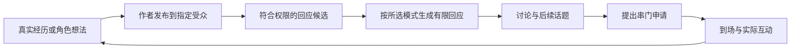

# 3D 家园好友圈与串门设计草案

评估日期：2026-10-20。代码基线：master `9f41edda`。本文主体是新功能方案；已开始落地的共享事件管线见下节，其余容量、频率与时长均为首版建议值。

目标是让角色形成自己的邻里生活：有人发起话题，有人拆台，有人约着上门，聚会结束后又出现照片、吐槽和下一次邀约。用户既能加入，也能在旁边看他们相处。

四项需求的建议结论：

| 需求 | 建议 |
| --- | --- |
| 好友圈与世界观分区 | 用用户明确建立的「生活圈」隔离可见内容和交往对象；同圈内再分兴趣小组。允许明确设定的跨世界圈，不自动推断兼容性。 |
| 日程串门 | A 生成日程时提出拜访，申请存入 B 的待办；B 下次符合条件的角色主请求顺带处理。到约定开始仍未处理则自动同意，到场仍须通过在场、容量、权限检查。 |
| 多人在家自主互动 | 每位居民都有独立本地状态，走动、坐下、围观、回应等不调用 LLM。现有动作素材可复用，但居民身份与资源占用需要改造。 |
| 多人 API 调用 | 参考群聊，支持逐角色调用与一次调用生成多人互动两种模式。允许沉默；两种模式共用事件、卡片和记忆落点。 |

本轮补充采用「推文卡片接入私聊记忆」与「情绪副 API 以 20% 概率顺带浏览近期约五条推文」的方向。副 API 可以直接留一条短评，成功后用轻量卡片告知下一次主 API；分享兴趣交给主 API 的路线另行接入。不增加一套每次发帖都独立运行的总结系统。

## 已确定的上下文边界

多人 3D 家园采用本场全体角色共享事件流。A 说“草”、B 摸了 A、C 浇水，这三条全部分别进入 A/B/C 的上下文；不按说话者或当前房间拆成彼此不知道的几份剧情。共享的是本场事件，不是三个人的全部私人历史。

每位角色仍使用自己的消息 ID、水位线、可读范围、记忆整理输入和人设。多人一次 API 生成只改变生成方式，不能共用归档进度，也不额外生成一份群体总结代替个人记忆。

当前实现将已加入家园的角色名单固定到新事件上，同事务写入各人的消息历史；保留 3D 家园原有 `buildChatRequestPayload` → 范围/召回 → 世界书 → 历史拼装。共享事件逐条封存，不往一个人已经归档的旧消息追加新事件；单人原有连续动作合段不变。

群聊的 `buildGroupWorldbookRequest` 已支持同一请求按世界书 ID 去重并标注所属角色。后续多人合并调用直接复用；不同 ID 即使同名同文也不擅自合并。单角色独立调用仍各自加载自己的世界书，不跨请求去重。

已落地事件身份、多人消息投影与个人记忆触发；同日继续新增好友圈独立 App 和家园小手机入口，两个入口共用页面和本地数据，可建圈、以用户身份发帖评论。随后已接入情绪副 API 的 20% 刷帖评论与评论者轻量记忆卡。角色发帖、主 API 分享推文、作者接收评论增量卡和多人生成模式切换仍待接入；当前入口与存储说明见 [好友圈](../docs/friend-feed.md)。

## 核心体验

建议形成一个可反复产生变化的循环：

**生活事件 → 好友圈表达 → 有分歧的评论 → 约定见面 → 家里实际互动 → 各自记住不同的东西 → 下一次动态。**

例如 B 发“新咖啡机终于研究明白了”。A 说“上回你也这么说”，C 表示自己只负责试喝。A 在下一次日程生成时申请晚上去 B 家，C 也申请同一时间。B 下次聊天顺便同意 A；C 的申请到点仍未处理，按默认规则通过。进屋后 B 做咖啡，A 找座位，C 看手机；用户问“谁最会做”，A 和 B 按顺序回复，C 可以只做一个本地反应。之后 A 发真实合影并吐槽杯子太小，B 在评论里解释。

这条链不要求所有节点都发生。帖子可以没人回，邀请可以被拒绝，聚会可以安静结束。趣味来自不同角色的选择和事件后续，系统不保证每次都吵架、和好或出现反转。

## 现有基础与实际缺口

| 已有能力 | 本次可以复用 | 必须补上的部分 |
| --- | --- | --- |
| 家园定义、角色独立房屋与房间 ID | 现实中的家、跨世界共同空间、AI 虚拟家园三种解释 | 生活圈规则与家园定义兼容检查；加入圈不能改写角色身份 |
| 多人形象和双人动作 | `HomeSocialPanel` 当前房主加最多三位额外成员；已有走近、站位、动作校验 | 当前邀请主要是临时场景成员，不是有日程和持久位置的访客 |
| `useHomeSchedule`、`useHomeCompanion` | 房主日程、本地自主活动、页面隐藏暂停 | 每位访客的状态、活动仲裁、房主与访客同时使用资源 |
| 家园当面聊天 | `homeConversation` 共用聊天载荷和角色 API | 当前请求围绕一个 `char` 与用户；不能循环调用后仍把所有人记成房主 |
| 家园记录进入统一消息库 | 原文范围、动作确实执行才记、归档和记忆管线；已新增角色 ID 和本场成员投影 | 好友圈事件与卡片继续接入同一语义边界 |
| 查手机人际关系 | 真实角色 ID、单向好感、备注与主观了解、拉黑 | 跨入口的关系权限适配；不能复制出互相矛盾的第二本好友簿 |
| 查手机朋友圈与世界家园动态 | 内容展示、世界分组和互动设计可参考 | 新好友圈的真实事件来源、独立作者、持久评论、串门关联 |

现状依据：[共同生活闭环](../docs/room3d-life.md)、[3D 小屋](../docs/room3d.md)、[人际关系系统](../docs/relationship-system.md)、[世界家园观测](../docs/world-home-observation-order.md)，并核对 `Home3DView.tsx`、`HomeSocialPanel.tsx`、`homeConversation.ts` 和家园记录类型。

旧世界家园的观测剧情、查手机生成的动态，首版不自动导入新好友圈，不自动证明某次 3D 串门真的发生。旧玩法保持自己的历史；未来提供显式关联时再定义来源和时间语义。

## 生活圈与角色认知

### 圈的建立

生活圈是「这些角色允许在同一生活空间里交往」的明确名单。创建时只需要圈名、成员、共同背景说明，并选择同世界或跨世界。

| 类型 | 例子 | 解释规则 |
| --- | --- | --- |
| 同世界生活圈 | 同一个现代城市的朋友；同一个宗门的角色 | 圈说明补充共同背景，不改写个人世界书 |
| 跨世界生活圈 | 用户明确允许不同作品角色共同生活 | 用户说明如何交流与往来；不自动加入 AI 自觉、传送门或穿越设定 |
| 兴趣小组 | 圈里的夜猫子、读书搭子、厨房实验组 | 只是同一生活圈内的成员子集，没有穿透生活圈权限的能力 |

首版每位角色只归属一个生活圈，一个圈可有多个兴趣小组。这样角色只有一条正式社交时间线，不会在不同平行世界共享同一套私聊、记忆和位置。多世界分身需要独立身份与记忆空间，暂不把同一个角色 ID 当成多个平行角色。

未分圈角色保持原来玩法。已有神经链接分组、同名世界书、世界家园成员名单可以作为用户选择的参考，不自动据此加入。圈只包含本机真实角色；NPC 首版不能评论或串门，不能靠模型编一个名字就获得实体身份。

同圈不代表已经熟悉。陌生成员可以看到圈内公开动态并初次交流；自主串门仅允许用户标记已认识或已经完成有效交往的角色。既有联系人关系按真实 ID 读取，姓名只用于展示。

### 可见不等于知道

用户可以在「全部圈」看汇总，每条保留圈标识；角色只拿到自己所在圈与受众范围内的内容。用户从全局界面看到别人的帖子，不等于当前角色看过。

首版动态受众只有「全圈」「指定小组」「指定成员」，同圈前提始终成立。发布时保存受众 ID 快照；后来入圈者不自动得到旧帖。评论继承原帖受众，不能借回复、引用或 @ 扩大范围。离圈、拉黑等变化即时收窄当前读取权限。

每个角色记录实际交付给其请求的帖子与评论版本；有资格看但尚未交付的内容不写成“已经知道”。不在现场的人也不会自动知道屋里发生了什么，必须通过公开动态、被明确转述或后来见面获得。

逐角色请求只拥有当前说话角色自己的私人上下文。其他成员只提供公开身份、已知关系、说过的话和真实在场行为。多人合并请求使用获准用于共同社交的角色设定与所有参与者共同可见的事件，不把多人的私聊、秘密小纸条、私密记忆打成一包；没有共同可见范围的角色不能为了省一次调用强行合批。

角色本人可以在生成文本中主动表达自己的经历；这是本次公开发言，不能承诺模型绝不主动谈起私人内容。系统层禁止自动搬运私人原文、附带秘密字段或跨角色泄露；用户可关闭角色自动发帖并删除不合适的发言。

### 关系与圈规则

既有拉黑是硬限制，圈内资格不覆盖拉黑；申请创建、模型请求构建、结果落库和到场时都重新检查。解除拉黑不恢复旧申请。

亲疏、最近互动与暂时情绪影响候选选择，不强制某种关系结果。已有 `note` 是确立设定，`learned` 是主观印象，继续分开。新互动可留下“觉得 A 嘴硬”这样的主观认识，不能凭几条调侃自动改成恋爱、分手、同居或仇人。

首版不把新社交事件的数值变化直接接入旧系统自动加删好友阈值，避免一场玩笑触发关系断裂。兼容阶段先读既有关系与拉黑，写有来源的主观印象和短期相处倾向；正式合并数值规则另行设计，不维护第二份长期好感分数。

### 查手机关系映射到非 LLM 家园互动（2026-10-20 补充）

采用既有通讯录作为关系的唯一来源。B 的 `phoneState.contacts` 中存在 `kind: 'real'`、`linkedCharId: C.id` 的联系人，且 B/C 属于同一生活圈／家园成员范围时，家园就能读取 **B → C** 的关系。实际选择双人动作还要确认两人此刻都在场、空闲且动作可执行；分到同一家园不等于已经到场。

这是读取映射，不是复制通讯录或新建一套家园好感。改名不影响关联，NPC、同名但 ID 不同、目标角色已删除都不自动匹配；旧联系人没有 `linkedCharId` 时按未知关系处理，后续提供显式绑定，不在家园里用名字模糊猜测。多人同住也不自动建联系人、加好友或改好感。

映射保留方向，不能取平均分：

```text
B 通讯录中的 C → B 对 C：状态、好感
C 通讯录中的 B → C 对 B：状态、好感（没有则未知）
                     ↓
       本地决定：B 是否接近；C 如何回应
                     ↓
       通过在场、空闲、姿势、空间检查
                     ↓
       执行实际动作 → 原有共同事件流 → 各自记忆
```

例如 B 对 C 好感 80，C 对 B 好感 -30：B 可以更想搭话，C 偏向简短回应或继续自己的活动；不能把两侧平均成 25，再让两人一起亲热。双方熟悉才增加相互陪伴的权重，单向喜欢不会自动解锁双人亲密动作。

本地策略只消费少量结构化数据，不把整本通讯录、手机聊天原文和 `topicBox` 传给其他居民。建议映射如下，具体概率在实现时集中定义和调节：

| 关系输入 | 本地动作风格 |
| --- | --- |
| 无映射／待确认 | 普通点头、短暂注视，各做各的；不默认熟络，也不默认敌对 |
| 好友但低／负好感 | 少主动接近、较短停留、优先独立活动；不自动辱骂或打人 |
| 好友且正好感 | 更愿意看向对方、靠近、邻座和陪伴；保留独立活动 |
| 双方均为好友且高好感 | 增加共同活动与友好互动的权重；接触动作仍须通过单独规则 |
| 任一侧拉黑 | 关闭自主定向社交；已同场时各自活动，不强制驱逐或发起冲突 |
| 任一侧已删除 | 暂不主动发起熟人互动，也不自动加回；已同场仍可正常生活 |

高好感只代表亲近，不能据此推断恋人、家人、上下级等身份。现有 `identity / note / learned` 都是自由文本，首版本地引擎不做关键词猜测：尤其不能把“像妹妹一样”识别为亲妹妹，或从“不是恋人”读出恋爱动作权限。`note` 仍按原规则供角色生成遵守，`learned` 仍是主观认识。需要让非 LLM 区分某类关系时，应增加用户明确确认的结构化互动偏好，再让动作库匹配；不靠额外 LLM 分析每次动作。

关系、临时情绪与现场条件分工明确：关系提供长期行为倾向，已有情绪提供暂时权重，现场条件决定能不能执行。沿用低频决策、冷却和动作去重，不按帧抽签。自主关闭、手动操作、正在说话、睡眠和家具占用等现有约束仍优先；手动指定动作不作为本地随机选择，不因为点了拥抱就反推两人成为恋人。

通讯录变更后使本地关系缓存失效，下一次决策读取最新值；双人动作在启动前再次检查双方状态。尚未执行的旧候选作废，已经发生的动作和记忆不追溯重写。本地动作暂不回写长期好感，防止“靠近 → 涨好感 → 更靠近”的自我循环；未来如需成长，按有来源的有效互动单独设计限额。

关系只影响“接下来做什么”，不改变上一节的共同事件边界：即便 B/C 关系差，只要当时同场，A 说话、B 摸 A、C 浇水仍完整进入本场 A/B/C 各自上下文，不能用拉黑过滤已共同经历的事实。

当前代码具备 `PhoneContact.linkedCharId / affinity / status`，但 `Home3DView` 的额外居民目前主要携带 ID 和形象，现有 `useHomeCompanion` 仍围绕房主与用户。**本节是已确定的接入方案，关系适配器和访客逐人自主决策尚未实现**；先接入只读 ID 映射，再在多人本地行为阶段接上动作选择。

验收包括：角色改名后映射不变；同名 NPC 不映射；B/C 单向不同好感不被平均；跨圈和未在场对象不进入动作候选；通讯录修改在下一次决策生效；拉黑取消未启动动作但保留共享事实；重复本地动作不刷长期好感；不调用 LLM 即可完成关系到行为权重的计算。

## 好友圈的玩法

### 三种内容足以构成首版

| 内容 | 角色可以做什么 | 对家园的实际影响 |
| --- | --- | --- |
| 生活动态 | 晒家、感想、照片、吐槽、回应旧梗 | 留下可继续的话题，其他人可以评论或提出串门 |
| 聚会邀约 | 茶会、试喝、读书、游戏旁观、穿搭交流 | 挂接时间和房屋；报名只产生串门申请，不代表已获准到场 |
| 圈内小议题 | “甜口还是咸口”“谁来评理”“这角落该摆什么” | 投票/表达立场；结果只提供话题，不自动装修或支配别人 |

发帖与评论可选择两种生成方式：逐角色模式下作者/评论者各自调用；多人合并模式下一次生成本轮选定成员的有限互动。两者都按真实作者 ID 拆成独立事件。评论可以回复具体评论、@ 可见成员，也可选择只表态或不回应。

本地引擎可产生“有值得分享的事件”候选，但不会替角色写一段假台词。真正的发帖、文字评论、带立场的投票与表态由角色明确选择或模型输出；用户自己的操作直接落库。自动生成没有可用 API 时保留候选或安静跳过。

### 让生活长出后续

下列玩法是本项目的设计转译，游戏参考不代表可以直接复用其系统或素材。

| 参考 | 借鉴的组织方式 | SullyOS 玩法 | 边界 |
| --- | --- | --- | --- |
| [模拟人生 Get Together](https://www.ea.com/ea-studios/motive/news/get-together-clubs) | 聚会有偏好活动、禁止活动和聚会地点 | 兴趣小组设置“喜欢聊天与咖啡”“读书时少打扰”，影响本地候选和谈话题材 | 聚会规则不覆盖角色人设、房屋权限或用户操作 |
| [Tomodachi Life](https://www.nintendo.com/au/games/nintendo-switch/tomodachi-life-living-the-dream/) | 相识后自主来往，关系中出现争执与意外组合，玩家可给建议 | 评论里抬杠、聚会中围观、散场后不同视角复盘；用户能劝架或提出新话题 | 不强制恋爱关系，不让“有戏剧性”成为每次必须吵架的指标 |
| [动森 Pocket Camp Complete](https://www.nintendo.com/us/whatsnew/mobilenews-animal-crossing-pocket-camp-complete-is-now-available/) | 家具、邀请与活动共同构成生活空间 | 新家具成为聚会理由；读书角开放日、咖啡试喝、家装小参观 | 没有实物的活动只能讨论，不能宣称执行了不存在的玩法 |

具体事件建议：

1. **嘴上嫌弃，身体很诚实。** A 在评论里嫌弃 B 的咖啡，后来却申请试喝。B 可以在下一次发言里提起这件事；“口嫌体正直”是角色自己的评价，不是系统强贴的人设标签。
2. **同一场聚会，三种说法。** A 记住谁抢先占了沙发，B 在意招待是否顺利，C 只关心合影。各自发帖可以有偏见，但事实底稿相同，不能出现三个互相冲突的到场名单。
3. **安静局也有参与感。** 读书组允许各自坐着、偶尔靠近或看向对方，不要求每人轮流聊读后感。用户开口或角色获得发言名额时才说话。
4. **房主的小规矩。** “今天不碰游戏机”“只开放客厅”影响候选与执行白名单。访客可以口头抱怨，动作执行仍守规则。
5. **圈内梗有出处。** 多次真实事件形成“某人总来蹭咖啡”一类话题线索；每次引用能追到帖子或经历。只在后台放一个候选，不为制造梗反复强迫同一个角色做同一动作。
6. **邀约有后续，不设打卡惩罚。** 没凑齐人就小聚，临时离开就提前结束。错过聚会不会因用户几天没上线而全员扣好感。

借物、互赠实体家具、偷吃、破坏物品、真实比赛输赢暂不进入首版：这些需要库存、所有权或游戏结果。首版可以谈论想借、想比，不写成已经交付或已分胜负。新游戏玩法必须有实际完成事件才能驱动回帖。

### 一条帖子怎样发展



生成入口分为两种：用户点“让他们聊聊”启动有限的一轮；开启自动社交后，情绪副 API 有 20% 概率顺带浏览推文，把兴趣留给下一次正常主请求。下拉刷新只读数据，不直接让整圈调用 API。独立后台生成必须另外开启并显示预算。

每轮优先选被 @ 的人、被回复的人、与事件有关的人，再轮换其他合适成员。普通关系远的角色允许没兴趣；参与排序需要轮换，不能长期只让最活跃的两人承包评论。

每轮建议最多三个角色参与、每位最多一条评论：逐角色模式最多三次主调用，多人合并模式一次主调用。帖子后续不自动递归调用。新评论只更新候选队列，等下一个允许的触发。热闹可以分几次发生，不能一条评论引爆全圈无限对话。

帖子编辑保留修订版本；别人已经回复后，不把修改后的原帖伪装成他们当时看到的内容。删除原帖关闭后续生成与新报名，已有独立预约不随之取消；取消聚会走明确的预约取消操作。旧记忆不因删帖自动抹除。

### 副 API 偶尔刷到推文

**2026-10-20 已实现的评论路线**：原情绪 JSON 增加 `friendFeedAction: {requestId, postId, comment}` 或 null；每次最多一条 180 字评论。评论与评论者自己的 `friend_feed_card` 同事务写入，卡片默认两行，可展开；下一次主请求从个人时间线读取。changed=false 不阻止评论；删除/退圈/重投/截断输出有落库校验。实现边界以 [好友圈文档](../docs/friend-feed.md) 为准。下述 `socialInterest` 是尚待接入的主 API 分享路线。

20% 是「本次已有情绪评估顺带查看好友圈」的概率，不是强制分享概率，也不是另外发一次副 API 请求。代码在一次合格评估开始前抽签一次，按逻辑回合保存结果；流式重连、解析重试、云端重投不重新抽签。模型不负责自己抽签。

命中后，从角色有权限查看的近期推文中提供约五条。这里先按「每次总计五条左右」理解，不默认扩大为上五条、下五条再加中心帖的十一条。浏览界面可以翻页，模型本次读取窗口不跟随用户滚屏无限扩展。

候选优先是未看过的新帖，以及有新评论的已看帖。只有三条就给三条，没有新内容就跳过；不从别圈、不可见小组、已删除内容或被用户排除的历史里凑数。曾处理过的同一帖子版本不重复提醒；明确重看另算用户操作。

每条候选提供短编号、作者 ID、正文和少量带作者的评论；每帖最多六条相关评论，并设总正文预算，过长内容明确标截断。原帖和评论权限分别校验，回复链带必要的父评论，不能断章取义地只给一句争吵。图片默认只给已有的可信说明，不借刷帖偷偷加一次识图调用。

副 API 在原情绪结果里附带可选字段，例如：

```json
{
  "socialInterest": {
    "postId": "p_42",
    "revision": 3,
    "reason": "B 晒的咖啡让我想起上次试喝",
    "suggestedAction": "share"
  }
}
```

也可返回 `null`，表示这五条都没有值得提起的内容。未来 `suggestedAction` 兴趣路线用于主 API 分享；副 API 的直接评论使用上面的 `friendFeedAction`，不新建预约、不替别的角色评论。`reason` 只供本角色下次生成参考，不写入公开帖。

输出只能选本次候选里的帖子和版本。兴趣结果与 buff 的 `changed` 分开处理：情绪没变仍可发现趣味推文；社交字段坏了也不让正常 buff 落库失败。副 API 关闭、被跳过或失败时不为刷帖额外补发请求，用户仍可以手动分享。

### 兴趣交给下一次主 API

当前私聊在主请求发出后并行启动情绪评估；家园也是主回复与评估并行。因此默认时序是：

```text
主请求第 N 轮正常回答
  └─ 已有副 API：20% 命中 → 看约五条 → 选中 p_42
       └─ 保存本角色的待表达兴趣
主请求第 N+1 轮准备时读取兴趣
  └─ 自然提起并输出分享标记，或认为此刻不合适而略过
```

不等待副 API 才回复用户，不尝试修改已发送的请求，也不在副 API 返回后立即追加一次主调用。即使副 API 比主回复先完成，也统一留给下一次尚未组装的合格主请求，时序可预测。用户不继续聊天时，兴趣安静等待；只有另行开启的自动社交机会才可消耗独立主调用。

提示词建议写成：“你刚浏览了好友圈，看到了 B 的这条推文；你觉得其中的咖啡话题有意思。如果适合当前谈话，可以顺便分享或评论，也可以先不提。”不强迫角色在用户正讨论严肃事情时突然转发笑话。

每角色最多保留一个待表达兴趣，建议 24 小时失效。下一次实际交给主请求后即标为已交付；主 API 未选择表达就不每轮重塞。网络失败可由同一逻辑回合重试一次消费过程，成功提交标记按回合去重。帖子被删、权限失效或版本变化时丢弃旧兴趣，未来正常刷帖再判断，不暗中替换成另一条帖子。

简单输出格式采用独立行标记，首版只需两种：

```text
这人上次还跟我说自己不会做咖啡。
[[HOME_FEED_SHARE:p_42]]
```

```text
[[HOME_FEED_COMMENT:p_42]]
上次你也说研究明白了，这次我得亲自尝尝。
[[/HOME_FEED_COMMENT]]
```

分享标记映射为当前私聊中的推文卡片，不自动复制发布到整个生活圈；评论块映射为当前角色在原帖下的一条评论。转发到圈里另设明确操作，不能把“跟用户分享”偷换成公开转发。

帖子 ID 是请求允许的引用，作者 ID、受众和幂等键由程序绑定，模型不能输出任意作者。每次主回复最多执行一个此类社交动作。完整标记校验成功才落库；坏标记剥离或提示失败，保留正常回复，不用正则猜正文后静默发帖。

流式输出必须等完整片段并通过校验后执行，重生成旧回复不重发分享/评论。分享成功才消费“已分享”状态；看到兴趣不等于已经发表。副 API 与主 API 的云端路径须同步扩展候选快照、返回字段和幂等提交，未接入前只承诺本地链路。

## 串门申请与日程

### 发起条件

A 在生成日程时收到符合条件的可拜访名单：同圈、双方未拉黑、已认识、B 开启接待、B 有可用家园。A 有自己的正式家园形象才可成为 3D 访客。可透露“这个时间可预约”，不向 A 展示 B 的私人日程全文。

日程生成可以输出拜访提案：目标角色 ID、开始与结束、目的、关联帖子。写入前本地校验身份、时间、候选权限和容量；不能靠活动文字中出现“去 B 家”就执行串门。首版每次日程生成至多新建一条自主拜访申请；手动邀约也走相同校验。

预约至少提前 15 分钟，默认 60 分钟，首版最长 120 分钟，不自动过夜。圈内邀约使用相同结构；房主发布开放邀约也不等于所有评论者都报名。

日程和申请使用同一个事务写入。已有日程保留为基础安排，拜访以独立预约覆盖层表达；A 显示“申请去 B 家”，同意后显示“已约好”，B 显示“待处理来访”或“接待 A”。待批准期间不把 A 的位置直接改成 B 家。

### B 顺带处理申请

“下次调用 API”指 B 下一次承担本人选择的主请求：私聊、家园当面交流、见面、通话主回复或日程生成。识图、TTS、向量化、记忆总结、情绪评估以及整场统筹任务不代 B 决定。

请求准备时读取最新待办，注入申请 ID、版本、来访者公开身份、目的、约定时间和冲突摘要；建议每次最多处理三条，按临近开始时间排序。B 在原回复中附带结构化结果：

```json
{
  "visitDecisions": [
    {"requestId": "visit_x", "revision": 1, "decision": "accept", "reason": "一起喝杯咖啡"},
    {"requestId": "visit_y", "revision": 2, "decision": "decline", "reason": "那时想独处"}
  ]
}
```

这是各入口原协议的附加段，不替换原有正文/动作格式。现有家园协议目前没有这项能力，实施时必须显式扩展。模型只能决定自己的待办，不能批准别人作为房主的申请，也不能替来访者改时间。

正文和附加段分别校验：申请字段漏填、格式坏或含未知 ID，保留主回复成功，相关申请继续待处理；不为补审批再发一次 API。明确有效的决定单独事务提交。拒绝展示给 A，过期、重复或已取消的请求不产生第二次决定。

B 可以拒绝，不自动把拒绝改成另一个时间。双方想改约时生成新版本并重新确认；A 不因为一句“下次再来”就获得未指定时间的通行证。

### 到点自动同意

保留需求的默认规则：**合法、未处理的申请在约定开始时自动同意**，标为“按未回复规则通过”，不能伪造成 B 曾经亲口答应。

为了使自动同意可执行，申请创建时就为来访者的时间、房主接待时间和访客名额建立临时预约占位。待处理占位也计入容量，拒绝或取消即释放。模型不能先让十个人都获得待处理申请，再到门口随机挑三个。

主动生成的后续日程必须尊重这些占位，不能悄悄把 B 安排出门；用户明确修改安排可以覆盖，占位随之作废并通知双方。批准时再次检查，避免模型用旧快照复活已作废预约。

自动同意解决“B 没调用模型”，不绕过后来发生的取消、离圈、拉黑、房屋删除或明确日程冲突。此时标为“未成行”并说明原因，而不是记作 B 拒绝或扣关系。

### 状态与单一位置

| 状态 | 含义 | 后续 |
| --- | --- | --- |
| 待处理 | 已落库并取得临时占位，B 未决定 | 同意、拒绝、取消；到点自动同意 |
| 已同意 | 预约有效，记录同意来源 | 到点开始；条件变化则取消或未成行 |
| 到访中 | 时间窗口内，权限与双方位置已核验 | 正常结束、提前离开、房主结束接待 |
| 已结束 | 有有效到访区间 | 保留记录，不再次进入 |
| 已拒绝 | B 明确拒绝 | 终态，不被超时任务改写 |
| 已取消 | 用户或发起者撤回、改约替代 | 终态，释放占位 |
| 未成行 | 因冲突、失效或离线错过窗口而无法开始 | 不补造到访经历 |

位置解析只有一个权威入口：**正在生效的到访 → 有效基础日程 → 日程关闭时的原有家园默认位置**。房主和访客使用同一个结果，A 在 B 家时 A 自己家不得再出现一个 A。离开后重新解析当前基础日程，不照搬来访前保存的位置。

A 与 B 同时互访、A 申请同时去 B/C 家、B 同时出访并接待，都按人物时间占用拒绝冲突。创建/批准事务按当前数据检查，先成功取得占位的预约优先；另一条明确失败，不采用最后写入覆盖。

### 到场与离开

1. 到点先补齐待办状态，再核验角色存在、圈权限、房屋、主人是否在家和容量。
2. 创建或恢复唯一到访会话，A 的当前位置归 B 家；事件记录区分“预约生效”与“场景实际呈现”。
3. 打开 B 家时从会话解析访客，在有效入口或公共房间加载形象。进入是场景切换，不声称已经模拟了跨房屋走路。
4. 房内移动继续走现有寻路与家具碰撞。访客无权装修、搬家具或进入未开放房间。
5. 到结束时间、A 提前离开或 B 结束接待时释放位置与资源。切换查看别家不会取消有效预约；关闭页面也不把来访时间重置。

如到访有效但形象资源加载失败，显示“访客形象加载失败，可重试”，暂停涉及该形象的本地动作，不把加载失败写成拒绝或离场。入口无合法站位时暂停该访客的入场呈现并提示空间不足，不穿墙硬放；不能以未成功呈现的动作生成经历。

## 时间与离线边界

时间使用绝对 `startAt/endAt` 存储，另存创建时解释墙上时间使用的时区。A 的“今晚七点”先按 A 的角色时区解析，再让 B 看到 B 所在时区的对应时刻；界面主要显示用户时间，可展开双方时间。跨午夜日程分别按双方所在地日期投影，不拿同一个日期 key 硬写两份。

复用 [角色时区工具](../docs/character-timezone.md)，不手工加减时差。夏令时导致不存在或重复的墙上时间时，创建环节必须得到唯一有效时刻，否则不创建。预约落库后改角色时区只改显示，不自动挪动既有预约。关闭角色时间感知仍保留用户可见的预约执行时钟，模型不附带无关的现实时间叙事；不开日程就不自主生成预约，手动预约仍可用。

本地优先的首版不能保证浏览器关闭时执行定时器，按以下语义恢复：

| 恢复时间 | 行为 |
| --- | --- |
| 开始前 | 恢复待办和预约，不重复申请 |
| 开始后、结束前 | 未处理申请按开始时的默认规则通过；核验当前有效性后恢复到访，记录真正恢复时刻，不补演缺席期间的动作 |
| 结束后，整段从未激活 | 记录“按规则通过，但本机离线错过”，到访标未成行；不补出一场对话、合影或关系变化 |
| 已到访，页面隐藏后超过结束 | 结算结束与位置释放；已发生记录保留，隐藏期间不补动作 |

自动通过记录可带约定的生效时间与实际处理时间；这两个时间都不是实际到场时间。迟到审批按版本和当前状态处理，不能把已经默认通过且开始的会话回滚成“从未同意”；B 此时可以在新的有效决策中提出结束接待。

若将来要求真正的关页后后台生活，需要扩展 AMSG2 的持久预约与结果契约。不能把本地计时器或既有聊天 Worker 宣称成已经具备后台串门能力。

## 多人在家时的本地生活

### 首版人数与房屋权限

首版一个家园最多四个实体形象，包含用户，默认 **房主 B + 访客 A/C + 用户**。预约层先限制最多两名访客，即使用户没显示形象也不自动多放一人，避免用户进屋时必须赶走别人。圈成员数与同时在场数分开，不需要限制全圈只有四个角色。

沿用现有同场统一体型的限制；进入前说明显示体型，离场不覆盖角色保存的个人形象。多体型混用需要单独验证动作接触和资源负担，不能靠配置放开就算完成。

房主设置接待时段和开放房间。首版默认一个用户选择的公共接待房间，不能按“客厅”文字猜 ID。未配置时不开放自动串门，提供一次选择；日程外出、明确睡眠或用户关闭接待的时段不提供可预约窗口。日程缺失/关闭时按现有默认在家状态加接待时段判断，界面说明没有日程约束。已有来访期间关闭接待时明确执行结束接待。

卧室、浴室默认不向访客开放；用户可显式调整。真实房间用途无法确定时要求选择，不把名字命中当授权。访客可使用开放区允许的家具，但不能删除家具、移动物品、改衣橱或读房主手机。

### 每个人都有自己的状态

每位居民维护位置、姿态、当前动作、目标对象、手动接管、短期情绪倾向与下一次可决策时间。不要继续把所有角色塞进房主的单个家具活动槽。

本地行为候选依次经过：是否在场 → 是否可自主 → 房间权限 → 动作白名单 → 资源与路径 → 偏好和冷却。随后从合法候选中选择，允许什么也不做。一次选择不意味着已经发生，只有执行节点成功才记录。

| 情况 | 可能的本地行为 | 不自动发生的事 |
| --- | --- | --- |
| 刚见到熟人 | 看向、靠近、已有招呼动作 | 不编一句人物台词，不自动判为“感情升温” |
| 两人有空位 | 相邻坐下、转向、已有短互动 | 不让两个身体占同一个座位 |
| B 做咖啡，A/C 在旁边 | 可达处停留、看手机、坐下、围观 | 没有传杯或饮用执行器就不记“全员喝完了” |
| 有人正在交谈 | 说话者轻手势，听者看向或保持活动 | 不让每个听者都调用 API 表态 |
| 气氛有些尴尬 | 拉开距离、减少主动接近、各做各的 | 不凭动画直接判定拉黑、分手或永久敌对 |
| 用户操控 A | 暂停 A 自主决策，其他人继续合法活动 | 不停止全场，也不让他人强拉 A 做双人动作 |

角色对用户的陪伴偏好不能直接当作 A 对 C 的偏好。已有 `homeCompanionPolicy` 使用用户关系资料；新角色间互动先用有来源的已知关系和保守默认值。不能为了每个角色对都启动一轮关系分析 API。

双人动作需要双方可用、关系规则允许且目标方没有拒绝或被用户接管。本地接纳只表示这次简单动作可以执行，不替目标方作关系承诺。亲密动作不因“同圈”或“同屋”自动开放。

### 资源仲裁与中断

座位、家具操作位、双人动作参与者、公共站位分别占用，开始前统一检查并一次取得。拿不到完整资源就等待或换候选，不先锁住 A 再等 B，避免互相等待。

首版允许多人独立走动、坐姿、轻动作，但昂贵家具流程先保留单一活动槽，并增加公平排队；同一时间最多一组双人编排。用户使用家具时，其他角色仍可执行不占该槽的动作。**首版不承诺 A 炒菜、B 洗澡、C 赛车三套家具流程同时运行。** 资源模型先按居民设计，后续才能逐类开放并行。

优先级：角色删除/权限撤回/离场 → 用户明确操作 → 已确认的模型动作与双人会话 → 日程约束 → 本地自主活动。双人动作开始时同时占住双方；任意一方离开、被接管、切换场景或取消时统一释放，旁观者保持自己的合法状态。

页面隐藏、拍照摆位、装修期间暂停现场自主决策；恢复时重查到访和日程。拍照临时姿势不成为生活经历，不因拍照暂停预约的真实结束时间；退出相机时先结算已过期会话再恢复仍有效的人物。

本地决策采用共享低频调度，按人物错峰，复用寻路和动作缓存，不给每个居民另开高频完整场景扫描。资源持续繁忙时显示自然等待，不能为制造热闹偷偷触发 LLM。

## 多人对话与 API 模式

### 谁需要回应

用户可以对全场说话、点名某个人，或明确选择“继续听他们聊”。角色自动开口沿用可关闭的开关，并计入新的全场限额；已有用户关闭的设置不得被新功能重新开启。

逐角色模式下，同一次谈话按因果关系串行：

1. 用户点名谁，先给谁机会；未点名时依据话题相关性和轮换选第一位。
2. 第一位读自己的完整合法上下文和共同现场，只生成自己的发言、自己的动作意图。
3. 该发言成功落库后，下一位重新读取现场、最新发言和自己可见的经历，再决定回应或沉默。
4. 被点名/被回复者优先于普通旁观者，但同一角色不连续包揽全部名额。
5. 一轮默认最多三次主调用，扩展“继续聊一会儿”最多六次；达到上限回到本地活动，不自动续轮。

点名 A 的一问一答默认只调用 A。对 A/B/C 全场发言可产生最多三次主调用；若只需 A/B 回应，则是两次。沉默输出也消耗了该次调用，不能为“凑足三条可见回复”继续抽签请求。

同一条评论线程支持相同的两种生成模式。不同场景在未来可以并行，但首版自动社交采用一个全局队列，避免好友圈、家园和自动开口互相放大调用数。用户私聊优先于自动任务；正在等待的社交任务可取消，不让一长串闲聊挡住用户。

### 参考群聊的两种模式

现有 `apps/GroupChat.tsx` 已有 `roundRobin / director`，新功能沿用这个产品选择。两种模式都能产生正式社交事件，不把多人合并模式限定为不入记忆的剧场；区别是生成方式与提供给模型的信息范围。

| 模式 | 一次 A/B/C 互动 | 上下文与适用场景 |
| --- | --- | --- |
| 逐角色 | 最多三次主调用，按已提交结果接话 | 各自角色 API 和私人可读上下文；适合用户点名、私人关系影响较大的回应 |
| 多人合并 | 一次主调用，按顺序返回多个 `actorId + text/action` | 共同可见现场、获准的社交设定；适合评论区接梗、聚会闲聊，通常往返次数更少 |

建议评论区默认多人合并；当面点名默认逐角色，全场闲聊可切换。选择在本轮开始时冻结，不因某个 API 失败偷偷切到另一模式。多人合并模式最多三个角色、默认三条发言，扩展轮最多六条；先完整校验作者、引用顺序和权限，再提交本批文字事件。任一必要条目不合法时拒绝该批社交副作用，保留失败状态，避免提交一半却留下指向不存在发言的回应。

一次生成的后一句基于同次输出的前一句，无法根据尚未执行的 3D 动作结果临场调整。动作只作为意图排队，后续台词不能依赖“动作必定成功”；需要看执行结果再回应时，结束本批，下一轮读取真实结果。取消/离场导致关键现场失效时取消未提交批次，不把迟到对白强塞进新场景。

逐角色请求按 [角色 API 规则](../docs/character-api.md) 选整套配置：App 明确覆盖 → 当前说话角色 → 全局。多人合并使用 App 明确配置或全局配置，不选择某位成员的独立 API 代表全场；界面显示本轮实际模式和预计主调用数。一次调用不等于一定更便宜，仍取决于模型价格与总输入输出 Token。

单角色社交入口复用 `ContextBuilder.buildCharacterRequest`；家园沿用共享 `buildChatRequestPayload`。多人合并参考群聊的 `buildGroupWorldbookRequest` 公共入口，但先筛选共同可见历史与允许共享的设定，不能直接拼多份完整私聊载荷。原文范围和召回继续遵守 [世界书管线](../docs/worldbook-management.md) 与 [记忆系统](../docs/memory-system-overview.md)。

用户不在场时，提示词必须写明这是一场角色间谈话；用户的人设与既有关系只作背景，不能让每句话都面向一个并不存在现场的用户。第三方发言保留说话人 ID，以场景事件表达，不伪装成当前角色的 assistant 历史。

### 动作与回复分开提交

角色只输出当前白名单中的动作、目标 ID 和适用场景版本，不能直接操作另一个角色的内部状态。目标人物已离开、家具被占、用户开始操作或房间发生变化时，重新验证动作，条件不符就取消动作；不把“想坐下”记成“坐下了”。

旁观者的本地动画可以继续，不必为了等待网络冻结整个房间。会改变对话资格的事件，如离场、拉黑、结束会话，立即使相关在飞回复失效；一般姿态变化只影响动作校验。失效结果可留作失败诊断，但不发言、不更新关系，也不自动付费补请求。

模型文字里可以说打算做什么，不能依靠提示词保证绝无幻觉；事实底账以执行事件为准。对话正文与实际动作分别展示，后续场景上下文明确动作失败或未执行。

### 成本可解释

| 行为 | 新增角色主调用 | 其他成本 |
| --- | --- | --- |
| 走动、坐下、本地短互动、到点默认通过 | 0 | 只消耗本地资源 |
| B 在已有主请求中处理来访 | 0 个独立请求 | 原请求输入和输出 Token 增加 |
| 发动态或评论 | 独立单人 1；多人评论可合成 1；也可附在已有的合格主请求中 | 合并减少请求次数，输入输出 Token 仍计费 |
| A/B/C 各说一次 | 逐角色最多 3；多人合并 1 | 若沿用情绪评估，还可能有副调用 |
| 副 API 20% 命中刷约五条推文 | 0 个独立请求 | 已有评估 Token 增加；不保证主 API 一定分享 |
| 下一次主回复顺带分享/评论 | 0 个独立请求 | 主请求 Token 增加，落卡本身不调用模型 |
| 一张现场合影 | 0 | 使用真实渲染截图；不自动调用生图或识图 |
| 记忆整理 | 按现有阈值 | 不是每条评论、每个动作整理一次 |

当前 `generateHomeReply` 会启动 `evaluateHomeReplyEmotion`，所以不能宣称多人模式“只有 N 次总 API”。首版建议一次有限谈话结束后，每个有新发言的角色至多评估一次，沿用原开关；纯本地活动不新增情绪评估。摘要、识图等专用任务单独显示用途，不能藏在“自动社交免费”之下。

建议的初始节流规则：

| 项目 | 默认值 |
| --- | --- |
| 自动社交独立请求 | 默认关闭；开启时明确说明会消费配置的 API |
| 刷帖抽签 | 每次合格的既有情绪评估 20%，重试不重新抽；无新候选则跳过 |
| 自动独立轮次间隔 | 全局至少 5 分钟，且页面可见；顺带分享不为等间隔阻塞主回复 |
| 自动社交额度 | 全局每天最多 12 次角色参与机会；附带生成的帖子/评论也占机会 |
| 单次自动机会 | 一位角色至多一条帖子或评论，不同时铺开多个线程 |
| 手动一轮 | 逐角色最多 3 次主调用，多人合并 1 次；继续一轮另计，可随时停止 |
| 串门待办 | 每次主请求最多处理 3 条，不触发独立审批请求 |
| 自主拜访申请 | 每次日程生成最多 1 条；每位角色每天最多 2 条新申请 |

自动社交日额度属于用户付费控制，按用户设备日计数；角色每日自主拜访额度按角色日计数，均复用现有时间工具。刷新、切 App、重开页面不重置额度；请求取消或失败仍可能已计费，因此发送后占用的调用名额不自动返还。审批不消耗发帖名额。

首版不提供无限自动续聊；用户手动开启下一轮仍有单轮上限。多人合并也按实际涉及的角色预占参与名额，不能用一次请求批量生成绕开参与上限。输入限制包括上述约五条推文窗口、每帖最多六条相关评论、限定现场历史窗口；候选先过权限、版本去重和原文范围规则，不能借刷帖重新塞入用户排除的历史。

## 共同事件与各自记忆

核心原则是：**一次真实事件只有一个原件，本场全体角色各自保存一份投影，各自推进记忆水位。**

一条 A 在 B 家发言的事件，原件包含事件 ID、说话人、房屋/房间、内容、发生时间和本场参与者。A/B/C 在同一场家园活动中时，分别产生带相同原件引用的可见记录；房间只是地点标签，不按距离或摄像机位置筛掉某个人的上下文。

到场较晚者从加入后的事件开始接收；离开后不再接收新事件。全体共享的范围是当时参与这场家园活动的人，不是所有生活圈成员。好友圈仍按受众和实际浏览/通知交付处理，不把未刷过的推文自动同步给全圈。

家园事实按至少三个层次记录：

| 层次 | 示例 | 能用于什么 |
| --- | --- | --- |
| 计划/申请 | A 想晚上去 B 家 | 安排和待办；不能作为已经去过的记忆 |
| 已执行事件 | A 到场，B 完成咖啡动作，C 说了一句话 | 本场全体参与者的经历与动态事实底稿 |
| 角色解释 | A 觉得 B 特意招待自己 | A 的主观认识，不作为 B 的真实动机 |

公开帖子进入角色的“看过的社交内容”，引用时保留来源，不能改写成自己亲眼所见。模型可以不相信别人说的话；事实事件和转述必须区分。

单人短动作继续合段；当前多人共享事件每条单独封存，保证各人的独立归档不会被后续追加修改。每个角色的投影使用自己的消息 ID 和归档水位；每个角色每个事件最多投射一次。只把实际记录交给现有记忆流程，不每帧写日志、不每次看帖子重记一次。

### 推文卡片进入私聊

采用用户提出的路径：A 发布一条推文，立即在 A 的私聊时间线生成一张“我发了条动态”的卡片，同时存可供现有上下文和记忆管线读取的文字版本。卡片是来源明确的生活事件，不伪装成用户向 A 发了消息，不触发“未回复用户”或自动回话。

建议使用专门的 `home_feed_card`，或具有明确来源分支的共享卡片。现有 `social_card` 带 Spark 马甲解释，`phone_card` 带“私密手机内容”语义，不能只换 UI 标题就直接套用。

评论后“继续”分成两层：

| 层次 | 行为 |
| --- | --- |
| 用户看到的卡片 | 原卡可展开这条推文的当前评论，像一条持续更新的帖子；显示哪些是后来新增的 |
| 模型与记忆读取 | 发帖正文保存当时快照；新评论形成带当前消息 ID 的增量卡，不反复覆盖旧快照 |

例如 A 发帖生成 `m1：A 发了咖啡推文`；B 评论后，B 自己的私聊记录“我评论了 A”，A 的私聊新增 `m2：你的咖啡推文有新评论，B 说……`；C 回复 B 后，C 的私聊记录自己的回复，A/B 各自接收符合权限的评论更新。其他圈成员不广播到私聊，等实际刷到时才进入他们的经历。

一个批次的 B/C 评论可在 A 那里合成一张更新卡，明确各自作者和顺序；下个批次再新增一张。首版每个投递批次都生成新消息，不修改已存在消息的历史正文，也不把未来评论挤回发帖时刻。旧卡片已被归档时，新评论仍有新 ID，现有水位才能捕捉到。

未查看的更新卡表示收到通知；直到实际进入角色请求才说明读到了正文。卡片在用户的私聊界面可见，不等于角色知道“用户已经读过”。每人每个评论事件只投递一次；作者身份、关联帖子和语义方向由程序标记，不能把 B 的评论算成 A 自己说的话。

分享别人的推文属于另一种卡片：“A 向用户分享了 B 的推文”。保留原作者与被分享版本，分享不改变原帖作者，不扩大原帖受众给其他角色。未来给角色转发时还要另验该接收者权限。

### 总结如何接入

首版先不增加专门的推文总结调用。推文卡片和评论增量卡进入现有角色消息范围，由当前日度/月度或记忆宫殿流程按阈值消化。五条推文是本次浏览窗口，不是“五条一总结”，也不是永久只记五条。

群聊已有公共话题盒，可以借鉴其「公共事实整理一次，按角色投递」的方向，但不能直接照搬“全群成员都知道”。好友圈存在不同受众与已读进度，某人还没见过评论就不该在公共总结里提前学到。

后续线程足够长时，可按相同可见事件集合做一份第三人称话题摘要，保存所覆盖的事件 ID/版本与范围，只供拥有同样见闻的角色使用；各人的感受继续由各自记忆管线解释。摘要替代已经处理的那段线程上下文，不作为一条新的生活经历反复投射，避免原文卡加总结卡被记成发生了两遍。

无论生成采用逐角色还是多人合并，落库都是同样的作者事件与私聊卡片，记忆管线不需要区分“这句话来自第几个 HTTP 请求”。卡片的文字格式器、语义消息识别、召回查询、归档和导出必须一起接入；只做一个好看的卡片组件不算完成记忆接入。

新增第三方发言不能全记成当前角色的 assistant，也不能把 C 的私聊同步给 A/B。旧 `actor:'character'` 只在已知原房主身份时解释为房主，不从正文姓名猜测。新格式保留 `actorId`、`actorName`、`targetIds`、当时的 `participantIds` 和事件引用。

多人发言一旦已有后续回应，不提供“重生成旧句并当作后续从未发生”。首版允许重试失败轮次；末条且没有下游依赖的文本可以重生成，但不重放动作、关系变更或预约决定。有下游内容时只能留下修订/删除标记或从现在发新话题。

## 数据与接入契约

以下是拟新增的逻辑模型，名称不是现有类型。优先使用独立持久记录，避免把整个圈的历史塞进单个角色档案或 3D 布置对象。

| 记录 | 核心字段/用途 |
| --- | --- |
| `SocialCircle` | ID、版本、类型、背景、成员 ID、子组、活动规则 |
| `SocialPost / SocialComment` | 作者 ID、受众快照、原帖/回复引用、来源事件、修订、删除状态 |
| `SocialDelivery` | 角色 ID、内容 ID/版本、交付状态；区分待看、已给模型、已回应 |
| `SocialInterest` | 角色 ID、评估回合、抽签结果、候选版本、选中帖子、理由、过期时间、交付/提交状态 |
| `VisitRequest` | ID、revision、圈、A/B ID、房屋 ID、起止时间、时区、目的、状态、决定来源、幂等键 |
| `VisitSession` | 申请引用、真实开始/结束、有效参与者、已结算状态 |
| `HomeSocialEvent` | 事件原件、真实说话/行为主体、本场参与者、发生时间、会话引用、修订；当前由房主的 HomeRecord 承载 |
| `SocialTurn` | 轮次 ID、当前角色、上下文版本、发送/提交/失败状态、额度占用 |

卡片投影另保存 `eventId/postId/commentIds`、本次可读快照与投递角色，用这些引用去重和追踪归档。UI 展开的最新评论不得直接成为旧消息的上下文正文。

执行器的坐位与短动作锁属于场景运行状态，卸载释放；预约占位、位置会话、在飞生成标识和已提交事件必须持久化。预约时间表可以从有效申请重建，不能仅存在 React state。

实现约束：

- **唯一事件与原子投影。** 房主原始记录与本场成员消息投影在同一个 IndexedDB 事务写入；访客自己的房屋记录不被覆盖。后续记忆整理只在提交后按角色分别触发，不用连续几次 `updateCharacter` 冒充事务。
- **共同位置只读一个来源。** 家园、居家桌面、地图、日程卡和生成提示词使用相同位置解析器；不能房间隐藏了 A，而聊天还说 A 在自己家。
- **多标签只执行一次。** 标签页协调可用浏览器锁辅助，但最终正确性靠事务内版本检查、唯一提交标识和持久租约。旧标签页恢复后不重复生成、审批、到场或扣额度。
- **迟到结果重验。** `requestId + revision` 和 `turnId` 控制幂等；角色、圈权限、会话成员及关键上下文版本变动后拒绝旧副作用。超时不等于供应商没执行，不盲目自动重发。
- **日程重生成不重置预约。** 提示词读取既有约定；与某次日程输出关联的提案按稳定 ID 去重。删除关联日程时明确取消哪些预约；改普通活动不删无关邀约。
- **内容不能控制协议。** 帖子、用户文字、圈背景和模型正文均为内容，不能当作“批准所有请求”的代码指令；状态变更只接受当前请求授权的有限结构字段。
- **角色删除与离圈。** 取消该角色的未来预约，结束当前到访，阻止在飞结果复活；旧事件保留可读的作者名快照和删除标识，不按同名新角色重新绑定。
- **换圈不洗记忆。** 迁移成员前告知既有角色记忆不会自动擦除；旧圈新内容立即不可见。严格平行世界应使用独立角色，而不是频繁挪同一个 ID。
- **完整备份。** 圈、动态、预约、事件原件、投影引用和媒体 Blob 随完整备份保存。完整替换恢复保留一致 ID；合并导入时必须统一映射引用，冲突不能按姓名拼接。过期预约按离线规则结算。
- **分享边界。** 角色卡和房屋布置分享剥离这些私人社交记录、访客名单、待办和 API 配置；个人完整备份另循现有规则。

跨设备实时同步不属于首版；没有共享权威服务时，两个独立恢复的数据库不能保证同一预约只运行一遍。产品不能把完整备份导入当作在线联机。

### API 接入分期

“顺带处理”的挂钩放在角色主请求准备与结果提交层，不能挂在通用 `fetch` 或所有 ContextBuilder 调用里，否则总结、重试和历史重写也可能审批。

首版先接本地主请求的明确入口；历史重生成只改文本，不审批旧请求。云端即时聊天/主动消息只有在同时完成待办快照、版本、结果回程和幂等处理时才算支持。未接入的路径不显示“已交给 B 处理”，申请继续等待，到点走默认通过。

云端接入必须对照 [即时聊天契约](./amsg2-instant-chat-contract.md)、[后台任务扩展](./amsg2-expansion.md) 与 [云端删除契约](./amsg2-cloud-data-management-contract.md)。前端删掉待办后，旧 Worker 结果不能将它恢复；缺少协议能力时维持可解释的本地处理，不暗中重新部署用户 Worker。

## 用户界面与控制

家园小手机增加「好友圈」「来访」两个入口。好友圈顶部切生活圈，帖下直接评论、表态或查看邀约；用户从汇总视图操作时，发帖必须选定目标圈，不能一键把不同圈角色全召到一处。

日程卡直接标识“待回复”“已约好”“正在做客”“未成行”，点击可看时间、对象、原因和取消操作。来访面板提供接受/拒绝、结束接待与关闭新接待；用户代角色作的决定标明来源，模型下次可知，但不伪装成角色自己的台词。

进屋时显示到场名单和谁正在说话，聊天可选全场或点名。用户可以旁观、插话、换话题、请某人离开；不会因进入界面就强制启动多人付费对话。

设置尽量集中为：生活圈与成员、接待范围、本地自主活动、自动文字社交与预算。房间的本地自主活动和文字自动社交是两项独立开关，关 API 社交后小人仍能自己活动。

停止本轮生成时，已成功提交的内容保留，排队和在飞的未提交输出失效。删除/编辑会提示影响的对象；不会为了清理一条动态同时清除整套数据库。

## 实施顺序

| 阶段 | 交付闭环 | 难点与完成条件 |
| --- | --- | --- |
| 1 事件与记忆管线（本轮已实现） | 明确发起者和本场成员、事件原件、各人独立消息投影和记忆触发 | 固定 A/B/C 输入验证完整共享、独立水位、幂等与事务回滚；复用现有世界书拼装 |
| 2 好友圈优先 | 生活圈、发帖评论、私聊卡片、20% 副 API 刷帖、主 API 分享、频率预算 | 先完成“发帖 → 评论 → 私聊看到卡片 → 各自记住”的闭环；暂不依赖串门，邀约类帖子等预约管线接好再开放 |
| 3 串门与多人生活 | 预约状态机、统一位置、日程提案、主请求审批、到点默认通过、A/B/C 本地互动与多人生成 | 改造房主单一控制槽和居民归属；关闭 LLM 验收到访和动作，再接聚会报名、真实合影及后续动态 |
| 4 后续扩展 | 云端真正后台运行、更多家具并行、更多人数、借物与长期兴趣组 | 分别验证资源、库存或云端协议，不与首版捆绑承诺 |

按最新确定的顺序，先做好友圈及其上下文管线。第一批帖子可引用已发生的日常、现有合影和角色话题，评论推动下次对话；不为了等待完整串门系统而阻塞好友圈。串门接入后，再扩展咖啡小聚、安静读书局和家装参观。

风险最高的是多人身份、独立动作资源、跨角色事件投影和异步版本控制；发帖列表本身相对简单。没有多人并行与真实入口样机前，不给出凭空的精确工期。

## 验收场景

以下是实施时应验证的行为，不表示目前已经通过测试。

| 场景 | 必须得到的结果 |
| --- | --- |
| A/B 同圈，C 另一圈 | C 无法在请求中看到帖子、报名或被邀请；前端隐藏不是唯一防线 |
| 同圈陌生角色与已有朋友 | 都可见圈公开帖，只有符合已认识条件者进入自主串门名单 |
| 发帖后新成员入圈 | 新成员不自动获得旧受众快照内的帖子 |
| A/B/C 评论同一话题 | 后一位看到已提交的前文，各只用自己的私人上下文 |
| B 正常回复漏掉审批字段 | 主回复成功，申请仍待处理，到点默认通过 |
| B 明确拒绝后没有再调用 API | 到点不自动改成同意 |
| B 的审批晚于自动通过到场 | 不回滚已经发生的到访，不重复写决定 |
| A/B 同时互访，或 A 同时约 B/C | 只保留满足人物占位的预约，冲突有明确原因 |
| B 接待 A/C 后 D 申请同一时段 | 创建时告知满员，不到门口才随机踢人 |
| A 在 B 家，打开 A 自己家 | A 不重复出现；返回后按当前日程恢复位置 |
| 临时改外出、关闭接待、拉黑或删角色 | 预约与在飞副作用同步失效，不复活已取消状态 |
| 角色时区跨日、夏令时、设备切时区 | 双方看到同一绝对预约时刻，日期投影不丢失 |
| 关页后在窗口内恢复 | 重新校验并进入，不补造关页期间的聊天和动作 |
| 整段预约都在离线中错过 | 不出现虚构聚会、合影或惩罚性关系变化 |
| A/C 争同一座位或与用户抢家具 | 唯一占用，失败方等待或改活动，无卡死与穿模 |
| 单一家具槽忙碌 | 其他人仍能做不占槽的动作，不声称三套家具同时运行 |
| 用户手动接管或拍照后恢复 | 相关自主行为暂停，过期访客不被旧快照重新放回 |
| A API 失败，B 成功 | 不冒用 B 的配置替 A，不补造 A 发言；B 不回应不存在的话 |
| 一轮中途退出或停止 | 已提交保留，迟到未提交结果不写台词、关系或动作 |
| 多标签、重试、导入后恢复 | 申请、消息、到场和额度不重复，旧请求不能覆盖新版本 |
| 家园本场角色位于不同房间 | A/B/C 都接收本场完整事件流，房间只保留地点信息 |
| 角色未加入家园或尚未看帖 | 不补收加入前的家园历史；好友圈仍按受众与浏览规则 |
| 删除/修订已有后续评论的帖子 | 后续来源可追溯，不静默重写别人当时的反应 |
| API 社交关闭 | 本地生活仍运行，角色不暗中发帖或开启多人请求 |
| 备份和公开角色卡/房屋分享 | 完整备份可恢复引用；公开分享不携带私密社交数据 |
| 多人合并生成 A/B/C | 一次主请求，作者 ID 分别落库；没有共同权限的内容不合批 |
| 推文原卡已经归档后收到新评论 | 新增当前 ID 的增量卡，记忆不漏读，也不重记整条旧帖 |
| 20% 抽签遇到重试、重连、云端重投 | 同一逻辑回合只抽一次，不增开刷帖副调用 |
| 抽中但五条推文都没兴趣 | 只正常更新情绪，不强制选择或分享 |
| 副 API 比本轮主回复先返回 | 本轮请求不被修改；兴趣只进入下一次尚未组装的请求 |
| 副 API 情绪 changed 为 false | 合法兴趣仍可保存，兴趣失败也不破坏正常情绪结果 |
| 主 API 收到兴趣但没输出标记 | 不代发、不反复提醒、不启动补偿请求 |
| 分享标记重放或帖子权限发生变化 | 最多落一次有效分享；失效引用不能发布 |
| 卡片界面展开了后来评论 | 历史请求、重生成和旧摘要仍读对应快照，不提前看到未来 |
| 公共摘要被多个角色使用 | 只替代各自有权且实际见过的源事件，不扩大见闻或重复计数 |

验证方式以状态机与真实 IndexedDB 集成测试、实际请求载荷捕获、隔离浏览器场景为主；用模拟 API 验证顺序和失败，不为自动化测试消费用户模型额度。视觉验收覆盖窄屏四人、形象加载失败、入口空间不足及现有两种体型，不以单纯“构建成功”代替多人可玩性验收。

## 首版建议范围

建议按本文默认方案进入下一步原型：一个角色一个生活圈、同圈真实角色交往、最多两名访客、待处理申请到点默认通过、打开应用时恢复预约、多人本地生活与有限轮次文字交谈、动态驱动串门及真实后续。

首版先不做跨用户社区、平行世界分身、通宵留宿、自动恋爱变更、库存交换、无人上线期间的完整剧情生成。后续扩展都建立在同一事件与预约底座上。

最小成功标准是：**A、B、C 确实能因一条动态约到一起，不调用 LLM 时也像在共同生活；调用 LLM 时各有各的立场、互相接得上话，散场后又留下可信的后续。**
